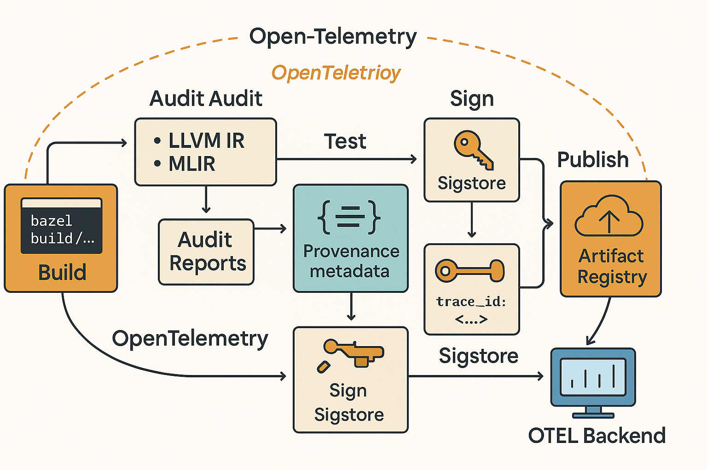

# NLSAFE — Experimental build provenance and IR auditing

**An applied research repository exploring where static intermediate-representation checks and build provenance can meet in a high-assurance software delivery pipeline.**

NLSAFE grew out of work on Rust, Bazel, and verifiable CI/CD infrastructure. Its constituent tools operate at different stages of a proposed build chain: scanning LLVM/MLIR intermediate representations, translating Bazel build-event records into SLSA-format provenance, and experimenting with integration into automated pipelines.

> **Status: experimental components and integration work, not a certified or independently audited secure-build system.** The repository should not be treated as evidence of end-to-end SLSA compliance, verified artifact signatures, or production-grade detection coverage. Some integration documents describe target workflows and future steps rather than completed deployments.

## Components

| Component | Purpose | Evidence in repository |
|---|---|---|
| [LLVM IR analyzer](llvm_ir_analyzer/) | Prototype Rust-based analysis of memory-safety-relevant operations at the LLVM IR level | Standalone tool and [component README](llvm_ir_analyzer/README.md) |
| [MLIR audit tool](mlir_audit_tool/) | Prototype analysis of dynamic reshaping and other operations that warrant scrutiny in MLIR | Standalone tool and [component README](mlir_audit_tool/README.md) |
| [BEP-to-SLSA interpreter](BEP%20-%20SLSA%20interpreter/) | Interpret Bazel Build Event Protocol JSON and emit structured provenance in an older SLSA v0.2 format | [Component README](BEP%20-%20SLSA%20interpreter/README.md), example BEP input, and scripts |
| [Integration layer](NLSAFE_integration_layer/) | Explore Bazel-target wiring, example audit inputs, CI/CD integration and provenance handoff | [Integration guide](NLSAFE_integration_layer/docs/NLSAFE_integration_README.md) |

## Intended architecture



The architectural goal is to bind **what was built**, **the static checks applied**, and **the source/build inputs** into an inspectable supply-chain record:

```text
Bazel build + build event data
              |
      +-------+--------+
      |                |
LLVM / MLIR audit     BEP parsing
      |                |
Static findings     Provenance fields
      +--------+-------+
               |
      Proposed attestations
      and CI/CD verification
```

Generating a JSON provenance statement is not the same as creating a cryptographically signed and independently verifiable attestation. Full chain-of-custody guarantees would require authenticated build identities, signing/verification, sound artifact-digest binding, and a trusted execution and policy environment. Those properties are **not claimed as complete here**.

## What to examine

- **IR scrutiny:** The two analyzers illustrate how build-time inspection can target lower-level representations instead of relying solely on source-language checks.
- **Provenance translation:** The BEP interpreter documents a mapping from build events to a provenance envelope. Its documented SLSA **v0.2** format should not be confused with current specification support.
- **Integration and limitations:** The [NLSAFE integration guide](NLSAFE_integration_layer/docs/NLSAFE_integration_README.md) documents intended Bazel/CI workflows and identifies unfinished signing and in-toto work.

## Research questions and next steps

- How should IR-level findings be represented and bound to specific built artifacts?
- What constitutes a reproducible, independently verifiable provenance chain rather than a merely descriptive report?
- Which static checks are meaningful enough to gate a release, and how are false positives and false negatives measured?
- How can the older provenance prototype be modernized and validated against current SLSA and in-toto conventions?

**Scope:** This repository is a record of early-stage systems research and prototypes. It does not establish that particular ML artifacts are safe, free from vulnerabilities, or compliant with a regulatory standard.

## License

[Apache 2.0](LICENSE).
